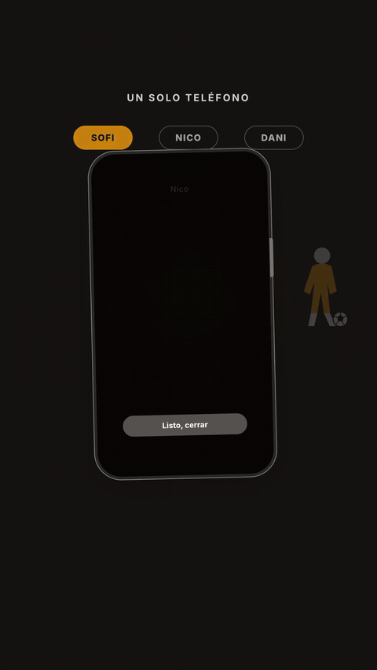

# El Impostor — Web

Frontend for **El Impostor**, a social deduction party game. Everyone gets the
same word except the impostor, who has to bluff without knowing it.

React 18 + Vite + TypeScript, Tailwind and shadcn/ui. Mobile-first: the whole
round is played on **one phone** that gets passed around, so a group of three
or more can play without installing anything.

> **Playable with zero API keys.** Login is optional; anonymous rounds still
> work. No LLM key is needed — the words and hints live in the API.

<p align="center">
  
</p>

## Quickstart

Start the [API](../api/README.md) first, then:

```bash
npm install
npm run dev          # http://localhost:5173
```

The API base URL defaults to `http://localhost:8000`, so the two work together
out of the box with no `.env`.

## Configuration

Vite inlines `VITE_*` variables **at build time**, so changing them requires a
rebuild (or a restart of `npm run dev`).

| Variable | Required | What it does |
|---|---|---|
| `VITE_API_URL` | No (`http://localhost:8000`) | Where the browser finds the API |
| `VITE_GOOGLE_CLIENT_ID` | No | Enables Google login. Empty = no login button |

```bash
cp .env.example .env
```

## Flow

1. **Jugadores** — add at least three names.
2. **Modo** — clásico, caos, aliados, espejo, infiltrados or random, plus
   difficulty and categories.
3. **Revisar** — launch.
4. **Ver en un solo dispositivo** — each player taps their name, flips their
   card in private and passes the phone.

The impostor's card shows a subtle hint when the category has one curated
(see `WORD_HINTS` in the API), and remembers that they don't know the category.

## Scripts

```bash
npm run dev       # dev server
npm run build     # type-check + production build into dist/
npm run preview   # serve the build locally
npm run lint      # eslint
npm test          # vitest
```

## Docker

```bash
docker build -t impostor-web --build-arg VITE_API_URL=http://localhost:8000 .
docker run -p 5173:80 impostor-web
```

The image is a static nginx build; `VITE_API_URL` is baked in, so pass the URL
the **browser** will use, not a container hostname.

## License

MIT — see [LICENSE](LICENSE).
